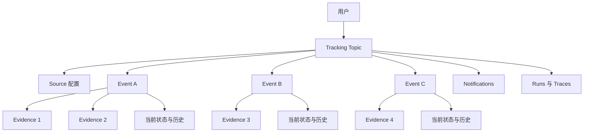
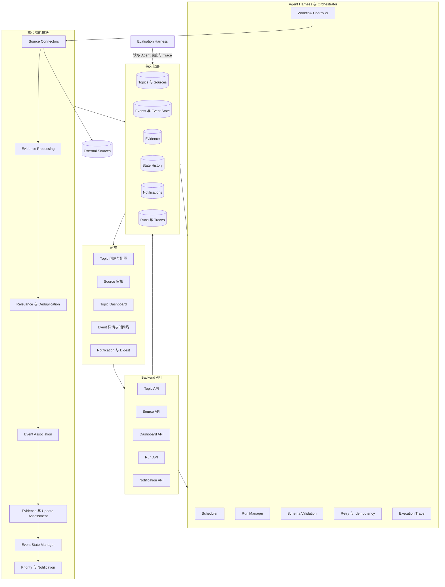
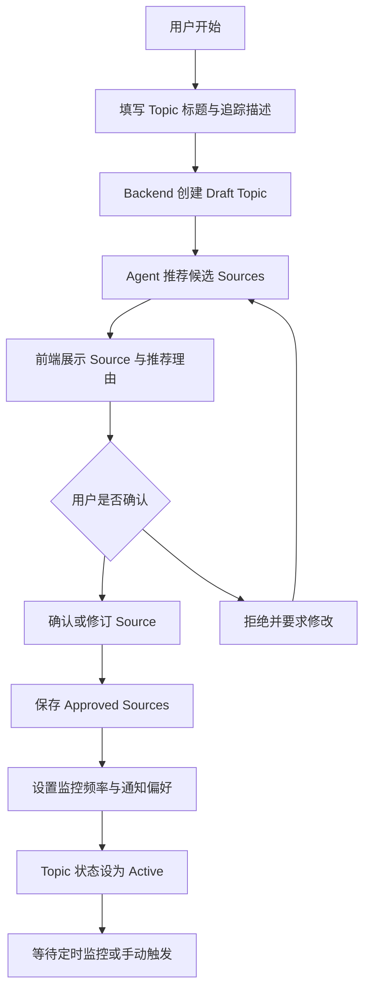
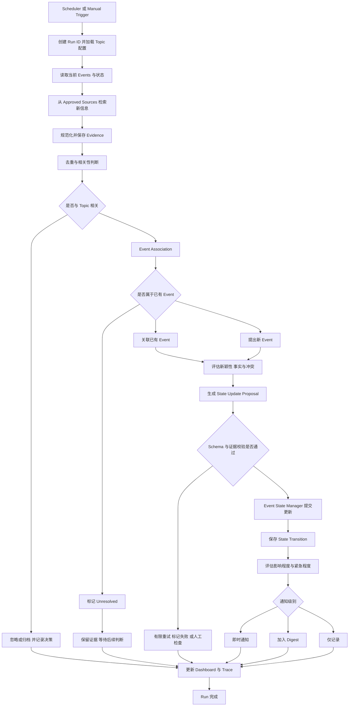
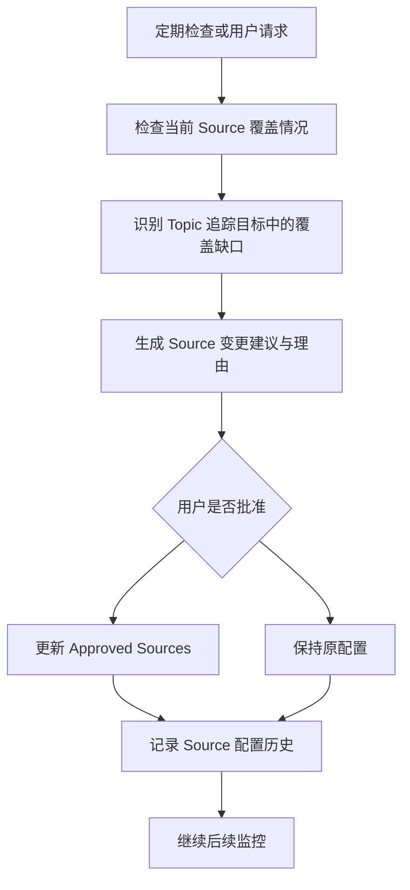
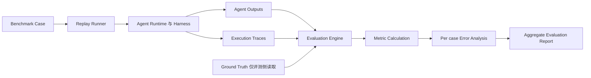
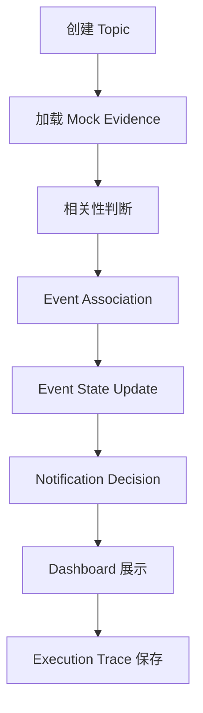

# Autonomous Event Tracking Agent：架构设计蓝图

> **版本：** 1.1（中文版）  
> **用途：** 小组内部架构对齐、模块分工、开发交接，以及后续交给其他 AI 作为项目开发上下文。  
> **项目阶段：** 课程项目 MVP 设计阶段  
> **核心原则：** 先跑通端到端闭环，再逐步替换 Mock、扩展真实数据源和完善评测。

------------------------------------------------------------------------

## 0. 文档说明与决策状态

本文档将小组目前已经达成的产品共识整理为可实施的软件架构，并补充必要的工程建议。为了避免后续开发时把建议误认为已经确定的决定，全文使用以下标记：

| 状态         | 含义                                                                     |
|:-------------|:-------------------------------------------------------------------------|
| **已对齐**   | 小组此前讨论中已经基本达成共识，除非小组明确调整，否则应作为当前设计基线 |
| **建议方案** | 为了降低开发和集成成本提出的工程建议，需要小组确认                       |
| **待决策**   | 目前尚未确定，开发前或对应模块实现前需要讨论                             |

本文档不是要求团队一次性实现所有内容。MVP 应优先完成一条可以运行、可以观察、可以评测的 Topic 生命周期。

## 1. 项目概述

### 1.1 项目定位

**Autonomous Event Tracking Agent（自主事件追踪 Agent）**：用户创建一个需要长期关注的 Topic，并描述自己的追踪目标。Agent 根据用户目标推荐候选信息源，由用户确认和调整后，系统持续监控这些来源。每次发现新信息，Agent 会判断其相关性、去重、关联已有 Event 或提出新 Event，分析证据是否改变当前认知，更新 Event State，并判断是否需要立即通知用户、加入定期 Digest，或仅记录在追踪历史中。

项目重点不是一次性搜索或生成新闻摘要，而是展示 Agent Engineering / Harness 能力：

- 按计划自主执行任务；
- 在受控范围内调用工具和数据源；
- 维护跨运行周期的持久化状态；
- 将新证据与已有事件、事实和历史联系起来；
- 对状态变化和通知决策提供依据；
- 支持失败恢复、去重、幂等执行和执行追踪；
- 通过固定 Benchmark 重复运行并评估系统表现。

### 1.2 当前已对齐的产品方向

| 项目                 | 当前共识                                                                                        |
|:---------------------|:------------------------------------------------------------------------------------------------|
| 产品形态             | 用户定义 Topic，Agent 持续追踪其下多个 Event                                                    |
| 核心层级             | **Topic → Event → Evidence**                                                                    |
| 初始测试领域         | Finance 与 Cybersecurity；架构不应限制只能用于这两个领域                                        |
| 用户配置流程         | 创建 Topic → Agent 推荐 Source → 用户确认/修订 → 设置追踪频率和通知偏好                         |
| 运行方式             | Agent 主动、周期性监控；开发阶段应支持手动触发                                                  |
| 更新处理             | 相关性判断、事件关联、状态更新、重要性判断                                                      |
| 通知方式             | 高优先级即时通知；常规更新进入 Digest；低优先级仅记录                                           |
| Event State MVP 字段 | `current_status`、`timeline`、`key_facts`、`sources`                                            |
| 评测方向             | Topic-level 评价，包含信息相关性、Topic 演化、Event 状态更新、通知质量、证据溯源与 Trace 一致性 |

### 1.3 MVP 暂不追求的内容

- 不要求覆盖互联网上所有网站，也不承诺真正的实时监控。
- 不要求完全自主地修改 Source 配置；MVP 中 Source 变更仍由用户确认。
- 不要求一开始就实现复杂的多 Agent 层级。
- 不要求一开始就引入知识图谱或复杂 Agent Framework。
- 不要求 Finance 与 Cybersecurity 共用完全相同的事件生命周期状态枚举。
- 不把 TrendRadar 视为已经确定的正式 Baseline。

## 2. 核心概念与数据关系

### 2.1 核心对象定义

| 对象                      | 定义                                                             | 示例                                            |
|:--------------------------|:-----------------------------------------------------------------|:------------------------------------------------|
| **Topic**                 | 用户希望长期追踪的主题或目标，可以比较宽泛，并包含多个 Event     | 某公司的经营状况与重大进展                      |
| **Event**                 | Topic 下一个相对独立的事件、发展事项或生命周期                   | 某季度财报发布；一次产品召回；某漏洞披露与修复  |
| **Evidence**              | 来自 Source 的原始信息或经过规范化的内容片段，带有来源和时间信息 | 港交所公告、公司年报、安全公告、研究论文        |
| **Source**                | 可以被系统访问的信息源及其连接器配置                             | HKEX 公告、arXiv、厂商安全公告 RSS              |
| **Event State**           | 系统当前对某个 Event 的结构化认知                                | 当前状态、关键事实、时间线、来源                |
| **State Transition**      | Evidence 导致 Event State 发生的一次变化记录                     | 新公告使财务预期状态发生变化                    |
| **Notification**          | 系统基于更新重要性和用户偏好生成的提醒或 Digest 条目             | 重大风险即时通知                                |
| **Execution Run / Trace** | 一次监控任务及其步骤、输入输出引用、决策、错误和耗时记录         | 某次定时任务处理了哪些 Evidence、为什么更新状态 |

### 2.2 Topic、Event、Evidence 的层级


**重要术语约定：** 用户在前端创建的是 Topic（或 Tracking Topic），而不是直接创建一个 Event。Topic 可以较宽泛；Agent 在后续追踪中逐步识别、创建和维护多个 Event。不要把”新增一篇文章”直接等同于”新增一个 Event”。

### 2.3 Event 的边界建议

这是一个需要小组确认的工程规则：

- 如果新信息只是已有事件的进展、补充、澄清或后续结果，应关联到已有 Event。
- 如果新信息描述的是一个具有独立发展过程、需要单独维护状态的事项，可以创建新 Event。
- 如果暂时无法确定归属，不应强行创建或合并；可以标记为 `unresolved`，保留证据并等待后续判断或人工检查。
- 同一事件的多篇报道不应因为来源不同而被拆成多个 Event。
- 新 Event 的创建应有结构化理由，并记录触发它的 Evidence。

例如，Topic 为”某汽车公司的经营与风险动态”，其下可能有”季度财报”“某车型召回”“海外市场扩张”“电池安全事件”等多个 Event。关于同一次召回的多篇报道通常应进入同一个 Event，而不是每篇报道创建一个 Event。

## 3. 总体架构

### 3.1 架构风格建议

**建议采用 Modular Monolith（模块化单体）作为课程项目 MVP 的部署方式。**

也就是说，代码按职责拆分为清晰模块，但最初不必将每个模块部署成独立微服务。这样可以减少部署、网络通信和集成负担，同时保留清晰的模块边界，方便多人并行开发。

### 3.2 逻辑架构图


图中是逻辑关系，不代表必须实现成独立服务。Evaluation Harness 与在线 Agent Runtime 应保持逻辑隔离，避免 Ground Truth 泄漏到 Agent。

### 3.3 模块职责总表

| 模块                    | 主要职责                                                         | 不应该负责的事情                     |
|:------------------------|:-----------------------------------------------------------------|:-------------------------------------|
| Frontend                | Topic 创建、Source 确认、配置监控偏好、展示 Dashboard/Event/通知 | 自己实现核心事件状态更新逻辑         |
| Backend API             | 参数校验、对外提供 API、触发任务、提供查询接口                   | 在 HTTP 请求中同步执行长时间监控     |
| Scheduler               | 按计划触发监控任务，支持手动触发入口                             | 自己抓取和理解文章                   |
| Orchestrator / Harness  | 管理一次 Run 的上下文、步骤顺序、超时、重试、幂等和 Trace        | 让 LLM 无约束地直接修改数据库        |
| Source Connectors       | 访问已批准 Source，处理分页、游标、限流，返回规范化原始条目      | 判断 Event 状态或通知级别            |
| Evidence Processing     | 内容规范化、元数据提取、去重、相关性判断和候选事实提取           | 直接提交 Event State                 |
| Event Manager           | Event 关联、新 Event 提议、状态更新验证、历史记录                | 编造无证据支持的事实，或静默覆盖冲突 |
| Priority & Notification | 根据影响、紧急程度、置信程度和用户偏好决定通知动作               | 反过来修改 Event State               |
| Persistence             | 保存 Topic、Event、Evidence、状态历史、通知和 Trace              | 接受不受追踪的任意写入               |
| Evaluation Harness      | 固定数据回放、读取输出和 Trace、对比 Ground Truth、计算指标      | 将 Ground Truth 提供给 Agent         |

## 4. 端到端工作流程

### 4.1 Topic 创建与 Source 确认


说明：

- Source Recommendation 的输出应包含来源名称、类型、访问方式和推荐理由。
- 用户确认后的 Source 配置需要持久化，后续监控只能使用已批准的 Source。
- 开发阶段允许手动配置 Source 或使用 Fixture Source，不应让 Source Recommendation 阻塞整个系统的开发。
- **监控频率**与**通知敏感度**是两个不同设置：前者决定多久检索一次，后者决定什么变化需要打扰用户。

### 4.2 主监控生命周期


建议把图中的各步骤实现为可单独记录状态的 Workflow Step。这样不仅方便调试，也能让 Evaluation 知道系统在哪一步做出了什么判断。

### 4.3 Source Coverage Review


Source Coverage Review 是 Source 管理分支，不需要每处理一篇文章就执行一次。MVP 中建议保留用户审批。

### 4.4 异常与恢复流程

| 异常情况         | 建议处理方式                                                    |
|:-----------------|:----------------------------------------------------------------|
| Source 抓取失败  | 记录失败原因并按有限次数重试；不能将抓取失败解释为”没有新信息”  |
| LLM 输出格式错误 | 进行 Schema Validation；允许有限修复/重试，仍失败则记录步骤失败 |
| Evidence 重复    | 关联到 Canonical Evidence，不重复创建状态变化和通知             |
| 新旧证据冲突     | 保留冲突双方，标记为待解决；不允许未经判断就覆盖已确认事实      |
| 通知发送失败     | 状态更新与通知发送分离；保留待发送/失败状态，独立重试           |
| Run 中断         | 根据 Run Step 状态恢复，或通过幂等机制安全重跑                  |

**关键顺序：先完成证据判断和经过校验的状态提交，再决定通知。** 通知应引用已经提交的 State Transition，而不是尚未落库的模型提议。

## 5. Event State 与结构化输出

### 5.1 MVP Event State

当前已对齐的基础结构：

``` json
{
  "current_status": "",
  "timeline": [],
  "key_facts": [],
  "sources": []
}
```

字段解释：

| 字段             | 含义                                      | 示例                                                                                        |
|:-----------------|:------------------------------------------|:--------------------------------------------------------------------------------------------|
| `current_status` | Event 当前状态的简要描述                  | `"Patch released"`                                                                          |
| `timeline`       | Event 重要发展节点，按时间记录            | `[{ "date": "2026-10-01", "event": "Vulnerability disclosed", "evidence_ids": ["ev_01"] }]` |
| `key_facts`      | 当前判断依赖的重要事实                    | `[{ "fact": "Affected versions are 1.x", "evidence_ids": ["ev_01"] }]`                      |
| `sources`        | 支持当前 Event 状态的来源或 Evidence 引用 | `["ev_01", "ev_02"]`                                                                        |

`open_questions` 和 `confidence` 曾被讨论为有价值的扩展字段，但目前不应视为 MVP 必须实现的字段。建议先保证四个基础字段的更新、持久化和历史记录正确。

### 5.2 Evidence 规范化对象（建议）

``` json
{
  "evidence_id": "ev_001",
  "source_id": "src_001",
  "url": "https://source.example/item",
  "title": "Example update",
  "content": "Normalized text or a reference to stored content",
  "published_at": "2026-10-01T09:00:00Z",
  "fetched_at": "2026-10-01T10:00:00Z",
  "content_hash": "sha256:...",
  "metadata": {
    "source_type": "official_advisory",
    "language": "en"
  }
}
```

`published_at` 与 `fetched_at` 必须区分：前者表示信息发布的时间，后者表示系统获取到信息的时间。对事件演化和延迟分析而言，两者意义不同。

### 5.3 Evidence Assessment 输出（建议接口）

``` json
{
  "evidence_id": "ev_001",
  "is_relevant": true,
  "event_association": {
    "type": "existing_event",
    "event_id": "event_001",
    "proposed_event": null
  },
  "novelty": "new_fact",
  "supported_claims": [
    {
      "claim": "patch_available",
      "evidence_ids": ["ev_001"]
    }
  ],
  "conflicts": [],
  "proposed_state_changes": [
    {
      "field": "current_status",
      "new_value": "patched"
    }
  ],
  "requires_review": false
}
```

这是接口示意，不是最终 Schema。建议使用稳定的枚举值表示机器决策（例如 `existing_event`、`new_event`、`unresolved`），同时保留自然语言理由供用户查看和错误分析。

### 5.4 Notification Decision 输出（建议接口）

``` json
{
  "priority": "breaking",
  "action": "immediate",
  "reason_codes": ["major_status_change"],
  "related_event_id": "event_001",
  "evidence_ids": ["ev_001"]
}
```

建议 MVP 采用以下映射：

| Priority | Action        | 用户看到的结果             |
|:---------|:--------------|:---------------------------|
| Breaking | `immediate`   | 立即通知                   |
| Routine  | `digest`      | 加入用户设定的 Digest      |
| Low      | `record_only` | 不主动打扰，只更新追踪记录 |

具体阈值尚待小组确定。检索频率与通知级别不能混为一谈。

## 6. 模块接口与 API 设计

### 6.1 模块间逻辑接口

以下是建议的模块输入输出契约。具体字段可以继续细化，但应在多人并行开发前统一名称、类型、必填/选填语义和错误格式。

| 接口 / 操作            | 输入                                                    | 输出                                               |
|:-----------------------|:--------------------------------------------------------|:---------------------------------------------------|
| `create_topic`         | `title`、`description`、`user_preferences`              | `topic_id`、`status`                               |
| `recommend_sources`    | `topic_id`、`tracking_goal`                             | 候选 `sources[]` 及推荐理由                        |
| `approve_sources`      | `topic_id`、`approved_source_ids`、`polling_config`     | 已保存的 Source 配置                               |
| `start_monitoring_run` | `topic_id`、`trigger`（scheduled/manual/replay）        | `run_id`、`status`                                 |
| `fetch_evidence`       | Source 配置、cursor 或时间窗口                          | 规范化 Evidence 列表、抓取状态、cursor             |
| `assess_evidence`      | Topic、当前 Events、Evidence                            | 相关性、去重、事件关联、候选事实和冲突             |
| `apply_state_update`   | `event_id`、经过校验的 update、`evidence_ids`、`run_id` | before/after state 引用、`transition_id`、执行结果 |
| `decide_notification`  | State Transition、用户偏好                              | priority、action、reason codes                     |
| `get_topic_dashboard`  | `topic_id`                                              | Topic 摘要、Events、最近/下次运行、通知摘要        |
| `get_event_detail`     | `event_id`                                              | 当前状态、时间线、关键事实、Evidence、历史         |
| `get_run_trace`        | `run_id`                                                | 有序 Trace、输出引用、错误和耗时                   |

### 6.2 建议 API 路由

以下以 REST API 为例，最终可根据团队选用的 Backend 框架调整：

| Method  | Route                                           | 用途                  |
|:--------|:------------------------------------------------|:----------------------|
| `POST`  | `/api/topics`                                   | 创建 Topic            |
| `GET`   | `/api/topics`                                   | 获取 Topic 列表       |
| `GET`   | `/api/topics/{topic_id}`                        | 获取 Topic 详情       |
| `PATCH` | `/api/topics/{topic_id}`                        | 修改 Topic 配置       |
| `POST`  | `/api/topics/{topic_id}/source-recommendations` | 获取 Source 推荐      |
| `PUT`   | `/api/topics/{topic_id}/sources`                | 保存用户确认的 Source |
| `POST`  | `/api/topics/{topic_id}/runs`                   | 手动触发监控          |
| `GET`   | `/api/topics/{topic_id}/dashboard`              | 获取 Dashboard 数据   |
| `GET`   | `/api/events/{event_id}`                        | 获取 Event 详情       |
| `GET`   | `/api/runs/{run_id}`                            | 获取运行状态和 Trace  |
| `GET`   | `/api/topics/{topic_id}/notifications`          | 获取通知列表          |

### 6.3 接口设计原则

1.  模块之间传递结构化对象，不依赖非正式的自然语言约定。
2.  每个关键对象使用稳定 ID，例如 `topic_id`、`event_id`、`evidence_id`、`run_id`。
3.  所有时间统一使用 UTC 时间戳存储；前端按用户时区显示。
4.  长时间监控任务通过 Run API 触发，API 返回 `run_id`，前端轮询或查询状态，不应一直等待 HTTP 请求完成。
5.  所有失败应返回可识别的错误类型，不要只返回一个无法分析的字符串。
6.  Event State 的写操作只能通过 State Manager 完成，避免不同模块直接修改同一份状态。

## 7. 持久化与数据存储设计

### 7.1 建议的逻辑数据表

建议 MVP 使用关系型数据库保存核心业务实体和审计记录。Graphiti 可以作为后续知识检索/记忆能力的候选组件，但在验证之前，不建议让它成为 Evidence 原始数据或 Canonical Event State 的唯一存储。

| 逻辑表              | 关键字段（示意）                                                                     | 用途                       |
|:--------------------|:-------------------------------------------------------------------------------------|:---------------------------|
| `topics`            | `topic_id`、`title`、`description`、`status`、`preferences`、时间戳                  | 保存用户追踪目标           |
| `sources`           | `source_id`、`type`、`endpoint`、`config`、`enabled`                                 | Source/Connector 注册信息  |
| `topic_sources`     | `topic_id`、`source_id`、`approved_by_user`、`polling_config`                        | Topic 与 Source 的批准关系 |
| `events`            | `event_id`、`topic_id`、`title`、`current_status`、时间戳                            | Event 当前状态             |
| `evidence`          | `evidence_id`、`source_id`、URL、标题、发布时间、获取时间、hash、content_ref         | Evidence 与来源信息        |
| `event_evidence`    | `event_id`、`evidence_id`、关联类型、置信度                                          | Event 与 Evidence 关联     |
| `state_transitions` | `transition_id`、`event_id`、before/after state、evidence_ids、时间戳                | Event 状态变更历史         |
| `notifications`     | `notification_id`、`topic_id`、`event_id`、action、priority、status、idempotency_key | 通知决策与投递状态         |
| `runs`              | `run_id`、`topic_id`、trigger_type、status、开始/结束时间                            | 一次监控/回放任务          |
| `run_steps`         | `step_id`、`run_id`、step_name、status、input/output refs、error、时间戳             | 执行步骤 Trace             |

### 7.2 数据管理原则

- **原始 Evidence 与派生 Event State 分开保存。** Event State 是当前视图，Evidence 和 State Transition 是审计依据。
- `published_at` 与 `fetched_at` 分开保存。
- 使用 `content_hash` 识别相同内容，避免重复摄取。
- 使用 `idempotency_key` 防止重试造成重复状态变化或通知。
- 对重要状态变化保存 before/after 快照或可重建的变更记录。
- 大型原文内容可以保存到文件/对象存储，数据库保留引用；MVP 可根据数据量简化。

## 8. Agent Harness 设计要求

Harness 是控制模型与工具执行的运行层。它决定任务何时启动、模型能访问哪些工具、各步骤如何执行、状态如何读写、失败如何恢复，以及执行过程如何被记录。

| Harness 能力      | MVP 要求                                                                       |
|:------------------|:-------------------------------------------------------------------------------|
| Orchestration     | 将监控流程拆成明确步骤，并记录每步状态                                         |
| Scheduling        | 支持定时触发与手动 Run Now；Scheduler 只负责触发，不直接执行复杂分析           |
| Tool Control      | 每次 Run 只能使用该 Topic 已批准的 Source/Connector                            |
| Structured Output | 对模型输出做 Schema Validation，校验通过后才能进入状态提交                     |
| State Management  | 只有 Event State Manager 可以提交持久化 Event State                            |
| Idempotency       | 重试不能重复创建 Evidence、State Transition 或 Notification                    |
| Retry / Timeout   | 有限重试、超时和退避策略；失败步骤可观测                                       |
| Human-in-the-loop | Source 变更需要用户确认；不确定的重要变化可以标记待审核                        |
| Traceability      | 记录 Evidence IDs、决策、工具调用、错误和耗时；不记录模型私有 Chain-of-Thought |
| Replay Mode       | 支持按时间顺序回放固定 Evidence，供 Evaluation 使用                            |

### 8.1 每次 Run 的基本状态

建议至少有以下 Run 状态：

- `pending`
- `running`
- `completed`
- `completed_with_errors`
- `failed`
- `cancelled`

每个 Workflow Step 也应有自己的状态，便于知道失败发生在哪一步。

### 8.2 Trace 最低记录要求

| 字段                                   | 作用                       |
|:---------------------------------------|:---------------------------|
| `run_id`、`topic_id`、`step_id`        | 标识一次运行及步骤         |
| `step_name`、`status`                  | 知道执行到了哪一步         |
| `started_at`、`completed_at`           | 计算耗时                   |
| `source_id`、`evidence_id`             | 追溯信息来源               |
| `relevance_decision`                   | 检查相关性判断             |
| `event_association`                    | 检查 Event 归属            |
| `update_proposal`、`validation_result` | 检查状态更新提议及校验结果 |
| `before_state_ref`、`after_state_ref`  | 检查状态变化               |
| `importance`、`notification_action`    | 检查通知判断               |
| `tool_name`、`tool_status`             | 检查工具执行情况           |
| `error_type`、`retry_count`            | 分析异常和恢复情况         |

## 9. Evaluation 集成设计

Evaluation 不应等到项目最后才临时补上。架构需要从一开始就产生可供评测的结构化输出和 Trace。

### 9.1 五项指标与系统可观测性

| Evaluation Metric                            | 系统必须暴露的数据                                                                |
|:---------------------------------------------|:----------------------------------------------------------------------------------|
| **Information Relevance**                    | 候选 Evidence、相关性判断、选中/排除结果；若要评估 Recall，还需要可访问的候选语料 |
| **Topic Evolution Accuracy**                 | Topic 下 Event 的创建/识别、Event 关联、关键里程碑和最终 Topic 状态               |
| **Event State Update Accuracy**              | 更新前后 Event State 快照、字段级变化、触发更新的 Evidence IDs 和时间戳           |
| **Notification Quality**                     | 重要性判断、最终动作（immediate/digest/record-only）、用户偏好和投递状态          |
| **Evidence Grounding and Trace Consistency** | Claim-to-Evidence 关联、Source 引用、State Transition 记录和有序 Execution Trace  |

### 9.2 Benchmark 与 Ground Truth 隔离

建议分为两个文件：

- `benchmark_cases.jsonl`：Agent 可以看到的 Topic 描述、初始状态、候选 Evidence/回放数据、来源元数据和时间戳。
- `ground_truth.jsonl`：仅 Evaluation 读取的人工标注，包括相关性、Event 归属、预期状态变化、通知标签和支持证据 ID。

两个文件通过 `case_id` 关联。**Ground Truth 不得进入 Agent Prompt、Agent Runtime 或可被 Agent 调用的工具上下文。**

### 9.3 Evaluation 数据流


Evaluation Harness 应独立于在线业务流程运行。它读取 Agent 输出和 Trace，并在评测侧读取 Ground Truth，计算指标和错误分析。

## 10. 候选技术选型

目前没有必须使用的 Framework。以下仅为候选方案，不代表小组已经决定。

| 层                  | 候选方向                                                    | 当前状态与建议                                          |
|:--------------------|:------------------------------------------------------------|:--------------------------------------------------------|
| Backend             | Python + FastAPI                                            | **建议方案**；适合 LLM、数据处理和评测代码              |
| Frontend            | React / Next.js，或组员熟悉的技术栈                         | **待决策**；优先选择团队能快速交付的方案                |
| Database            | SQLite 原型；需要并发或部署时考虑 PostgreSQL                | **待决策**；建议封装 Repository，减少迁移成本           |
| Scheduler           | APScheduler 或简单后台 Worker                               | **待决策**；先支持手动触发                              |
| Agent Orchestration | 显式 Python Workflow / State Machine                        | **建议方案**；不要求特定 Framework                      |
| Knowledge Graph     | Graphiti                                                    | **候选方案**；先做小规模 POC，与普通结构化状态+检索比较 |
| Retrieval           | RSS、官方 API、公开 Feed、固定回放数据                      | **待决策**；先选少量稳定来源                            |
| Baseline            | Retrieval + Deduplication + Summary；可选简单 State Tracker | **建议方案**                                            |
| 外部对比            | TrendRadar                                                  | **相关项目/候选对比对象**；尚未确认是正式 Baseline      |

**选型原则：** 优先保证完整生命周期可运行、数据可追溯、指标可计算，而不是为了使用某个热门框架增加复杂度。Graphiti 只有在确实改善跨 Event 关联、时序事实检索或证据追踪时才值得引入。

## 11. 建议代码仓库结构

以下按 Python Backend + Web Frontend 的模块化单体方式示意。最终目录可以随技术栈调整，但职责边界应保持一致。

``` text
project-root/
├── backend/
│   ├── app/
│   │   ├── api/                 # HTTP routes、请求/响应模型
│   │   ├── core/                # 配置、日志、公共异常
│   │   ├── domain/              # Topic、Event、Evidence 等领域模型
│   │   ├── services/
│   │   │   ├── topic_service.py
│   │   │   ├── source_service.py
│   │   │   ├── retrieval_service.py
│   │   │   ├── evidence_service.py
│   │   │   ├── event_service.py
│   │   │   └── notification_service.py
│   │   ├── orchestration/       # Run Manager、Workflow、Scheduler
│   │   ├── repositories/        # 数据持久化接口与实现
│   │   └── main.py
│   ├── tests/
│   └── requirements.txt
├── frontend/
│   └── src/
│       ├── pages-or-app/
│       ├── components/
│       ├── services/            # API Client
│       └── types/               # TypeScript 类型
├── evaluation/
│   ├── schemas/
│   ├── benchmark_cases/
│   ├── ground_truth/            # 仅评测侧读取，Agent 不可访问
│   ├── replay/
│   ├── metrics/
│   └── reports/
├── fixtures/                    # Mock Sources、样例 Evidence
├── docs/
│   ├── architecture.md
│   ├── api_contracts.md
│   └── annotation_guidelines.md
├── .env.example
└── README.md
```

## 12. 四人团队分工建议

目前小组共 4 人，且大家都有开发能力。建议采用”一个集成负责人 + 三个模块负责人”的方式。以下分工是初始建议，应该根据每个人的实际偏好和技术熟悉度调整。

| 成员角色                                   | 主要负责                                                     | 协作内容                                               |
| :----------------------------------------- | :----------------------------------------------------------- | :----------------------------------------------------- |
| **成员 A：Architecture & Evaluation Lead** | 架构设计、数据契约审核、Evaluation Schema、Benchmark、Ground Truth、指标和实验分析 | 审核 Event State 与 Trace 设计；确保架构产出可评测数据 |
| **成员 B：Integration / Backend Lead**     | 仓库骨架、Backend API、持久化、Orchestrator、集成分支和端到端流程 | 负责接口落地、联调和集成测试                           |
| **成员 C：Retrieval & Evidence**           | Source Connector、Source 配置支持、内容规范化、去重和 Evidence Processing | 提供 Mock Fixture 和检索/证据测试                      |
| **成员 D：Event Logic / Frontend**         | Event Association、State Update、Notification Logic、Dashboard | 按接口契约实现；若前端工作量大，可与其他成员调整模块   |

分工原则：

- 必须明确一位 **Integration Owner**，负责让主分支始终可运行。
- 必须明确一位 **Evaluation Owner**，负责 Benchmark 和评测结果。
- Architecture Owner 不应同时承担整个 Backend 的实现和所有集成工作。
- 每个模块负责人应对自己的接口、测试和 README 负责，而不是只提交一段核心代码。

## 13. 开发阶段与验收标准

### Phase 0：Architecture / Contract Alignment

**交付物：** Topic、Event、Evidence 数据结构；模块边界；接口契约；代码仓库规划；成员负责人。

验收标准：每个成员都能清楚说明自己模块的输入、输出、依赖和责任边界。

### Phase 1：最小端到端骨架（Thin Vertical Slice）

**交付物：** 使用 Mock Topic、Mock Evidence 和 Mock Source 跑通完整流程：


验收标准：不依赖真实外部数据源，也能完成一次从 Topic 到状态更新、通知决策和 Dashboard 的闭环。

### Phase 2：接入真实 Retrieval

**交付物：** 至少接入选定 Demo 场景所需的真实 Source；Evidence 规范化和去重可用。

验收标准：抓取结果能够追溯到 Source，重复内容不会反复触发更新。

### Phase 3：持久化与完整生命周期

**交付物：** Source 用户确认、定时/手动 Run、Event State History、通知、异常处理和恢复。

验收标准：同一批 Evidence 重跑不会重复生成事实、状态变化和通知。

### Phase 4：Evaluation

**交付物：** 小规模 Pilot Benchmark、Ground Truth、Replay Runner、五项指标计算和 per-case 错误分析。

验收标准：同一案例可以重复运行，评测输入和 Ground Truth 隔离，指标结果可复现。

### Phase 5：Demo-ready

**交付物：** 稳定前端、Finance/Cybersecurity 演示案例、评测结果和运行说明。

验收标准：演示者可以创建 Topic、确认 Source，并观察一次完整更新及其证据、状态和通知。

## 14. 开发前必须确认的 P0 问题

| 问题             | 为什么重要                               | 建议 MVP 默认方案                                            |
|:-----------------|:-----------------------------------------|:-------------------------------------------------------------|
| Event 创建规则   | 避免不同模块对 Event 拆分/合并理解不一致 | 只有独立发展事项才创建新 Event；同一事项的新报道关联原 Event |
| 更新动作词汇     | 影响 Agent 输出和 Ground Truth 标注      | 使用少量通用机器标签，保留领域特定状态文本                   |
| 初始 Source 范围 | 决定 Retrieval 复杂度和 Demo 稳定性      | 每个演示领域先选择少量可靠来源                               |
| 监控频率         | 影响 Scheduler 和演示流程                | 可配置；开发阶段支持手动 Run Now                             |
| 通知规则         | 是 Notification Quality 的评测基础       | Breaking=即时；Routine=Digest；Low=仅记录，阈值可配置        |
| 冲突处理         | 防止未经验证的事实覆盖                   | 保留冲突证据，标记待解决                                     |
| 数据库           | 影响实现但不应阻塞接口设计               | 选团队最熟悉、最快能集成的方案                               |
| Graphiti         | 可能引入额外数据模型和集成成本           | 先做小型 POC，不作为主流程前置依赖                           |
| TrendRadar       | 公平比较需要输入和输出可比               | 先作为 Related Work / 候选对比对象                           |

## 15. Architecture Owner 的交付标准

你负责架构设计时，不需要替所有人写完代码。你的工作达到以下标准即可：

- [ ] 全组统一 Topic → Event → Evidence 的定义。
- [ ] MVP Event State 和 Evidence 数据结构得到确认。
- [ ] 模块边界和输入输出契约经过模块负责人审核。
- [ ] Integration Owner 已经有一条可运行的 Mock End-to-End Workflow。
- [ ] Trace 字段能够支持五项 Evaluation Metrics。
- [ ] 所有未决技术问题都明确标注，并有负责人和决定时间。

## 16. 给后续 AI 的开发交接提示词

可以将本文件连同 Project Development Handoff 和 Event Evolution Benchmark Evaluation Specification 一起提供给后续 AI。

``` text
你将协助开发 Autonomous Event Tracking Agent。请先完整阅读架构文档，并输出：
1. 已确认的产品需求与架构决策；
2. 尚未决定、需要向团队确认的问题；
3. 建议的代码仓库结构；
4. Topic、Event、Evidence、Notification、Run 等数据模型；
5. 各模块的输入输出接口和 API Contract；
6. 第一阶段 Thin Vertical Slice 的具体实现计划。

不要擅自将 Graphiti、LangGraph、TrendRadar 或某个数据库视为已确定依赖。
不要在接口和 P0 决策未确认前直接生成大量代码。
先用 Mock Evidence 跑通端到端流程，并确保主分支持续可运行。
每一次 Event State 变化和 Notification Decision 都必须能追溯到 Evidence IDs，
并被 Evaluation Harness 读取。
Ground Truth 只能由 Evaluation 读取，绝不能进入 Agent Runtime。
```

------------------------------------------------------------------------

## 附录 A：建议先实现的最小接口约定

为了让四个人能够并行开发，建议至少先统一以下几个核心对象：

| 对象             | 必需标识                      | 关键内容                                        |
|:-----------------|:------------------------------|:------------------------------------------------|
| Topic            | `topic_id`                    | 标题、描述、Source 配置、监控偏好、通知偏好     |
| Event            | `event_id`、`topic_id`        | 标题、当前状态、时间线、关键事实、来源引用      |
| Evidence         | `evidence_id`、`source_id`    | URL、标题、内容引用、发布时间、抓取时间、hash   |
| State Transition | `transition_id`、`event_id`   | before/after state、触发 Evidence IDs、时间     |
| Notification     | `notification_id`、`topic_id` | priority、action、相关 Event/Evidence、投递状态 |
| Run              | `run_id`、`topic_id`          | trigger、状态、开始/结束时间                    |
| Run Step         | `step_id`、`run_id`           | step 名称、状态、输入/输出引用、错误和耗时      |

## 附录 B：重要工程约束

1.  **不要让 LLM 直接写数据库。** 模型输出先经过结构校验，再由确定性的 Service/State Manager 执行提交。
2.  **不要把抓取失败当成没有更新。** 这两者在状态和 Trace 中必须区分。
3.  **不要把重复报道当成独立证据。** 去重后应保留来源关系，但不能重复增加事实置信度。
4.  **不要让未经证实的传闻覆盖已确认事实。** 冲突应显式记录。
5.  **不要重复通知同一变化。** 需要幂等键和通知去重。
6.  **不要将 Ground Truth 暴露给 Agent。** Benchmark 输入与评测标注严格分离。
7.  **不要为了图谱而图谱。** 先证明 Graphiti 对项目核心指标有帮助，再决定是否集成。
8.  **不要记录模型私有 Chain-of-Thought。** 记录结构化决策、证据引用、工具结果和执行步骤即可。
